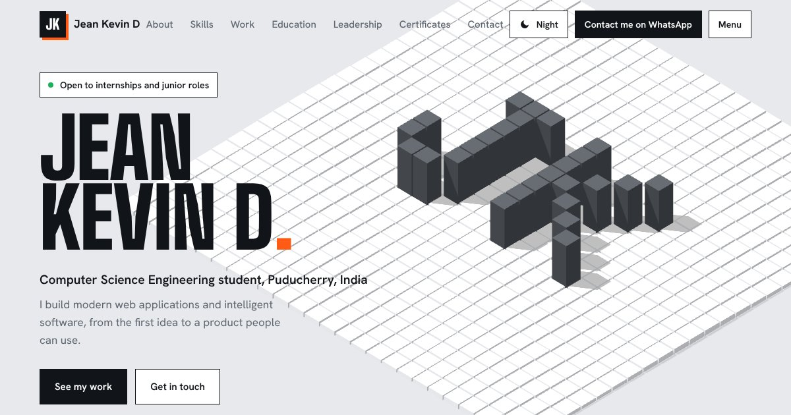

# Jean Kevin D — Portfolio

My personal portfolio website: **https://jeankevin.vercel.app**

It shows who I am, my skills, my projects (with case studies), my education and my certificates.
It is a plain static website (HTML, CSS and JavaScript, with Three.js for the 3D block background). There is no build step and no database.



## How to change something

Almost everything you see on the page comes from **one data block** at the top of the script in `index.html`
(look for `EDIT YOUR DETAILS HERE`).

| I want to change… | Edit this in `index.html` |
|---|---|
| Name, email, GitHub, LinkedIn, WhatsApp | `ME` |
| About text and quick facts | `ABOUT`, `FACTS`, `STRENGTHS` |
| Skills | `SKILL_GROUPS`, `STACK_ORDER`, `USED_IN` |
| Projects | `PROJECTS` |
| Education, leadership | `EDUCATION`, `ACTIVITIES` |
| Certificates | `CERTS` (put the image file next to `index.html`) |
| Resume | replace `Jean-Kevin-D-Resume.pdf` |

Case study pages live in their own folders: `brainy-blooms/index.html` and `brainy-blooms-assessment/index.html`.

## Everyday workflow (VS Code)

1. Open the **Source Control** panel. Click the branch name at the bottom-left → **Create new branch** (for example `fix/typo-in-about`).
2. Make your change and save.
3. Type a message like `fix: correct typo in About` → click **Commit** → click **Publish Branch** / **Sync Changes**.
4. On GitHub, click **Compare & pull request** → **Create pull request**.
5. Wait for the green tick (CI) and open the **Vercel preview link** to see the change.
6. Click **Squash and merge**. The live site updates by itself in about a minute.

Nobody deploys by hand.

## Run the checks on your computer (optional)

You need [Node.js 22](https://nodejs.org/). Then, in the VS Code terminal:

```bash
npm run check      # lint + secrets + build check + tests (the same as CI)
npm start          # opens a local copy of the site at http://localhost:3000
```

Or use **Run and Debug** → "Run all checks".

## Folder map

```
index.html              the whole home page (data block at the top of the script)
brainy-blooms/          Brainy Blooms Work Tracker case study page
brainy-blooms-assessment/  Brainy Blooms Student Assessment case study page
next/                   logo for the "next project" teaser
cert-*.jpg              certificate images
docs/                   requirements, architecture, deployment
scripts/                the checks that CI runs
tests/                  automated tests
.github/workflows/      CI (on every pull request) and the live-site check
```

More detail: [docs/requirements.md](docs/requirements.md) · [docs/architecture.md](docs/architecture.md) · [docs/deployment.md](docs/deployment.md)
